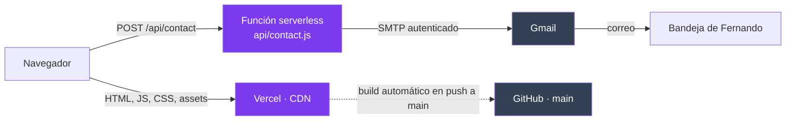
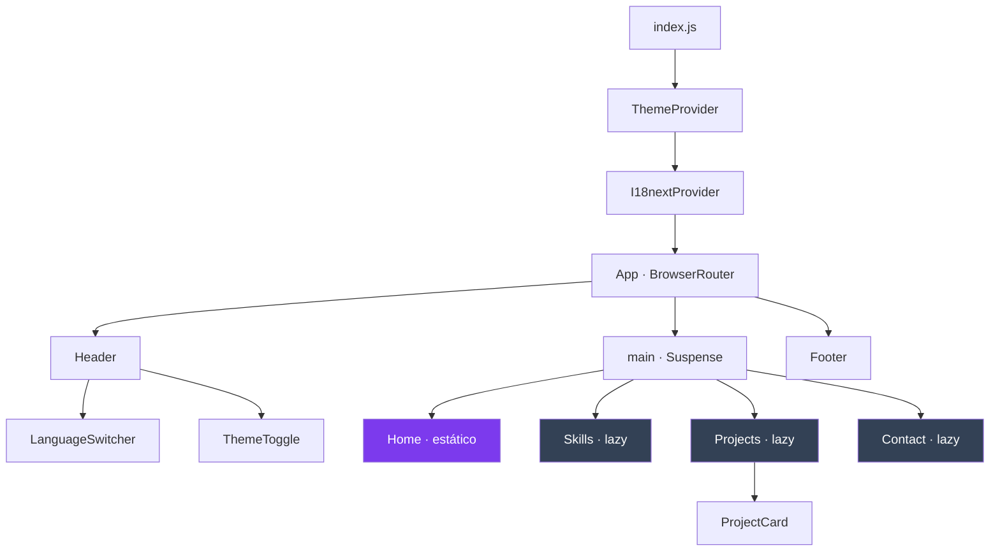
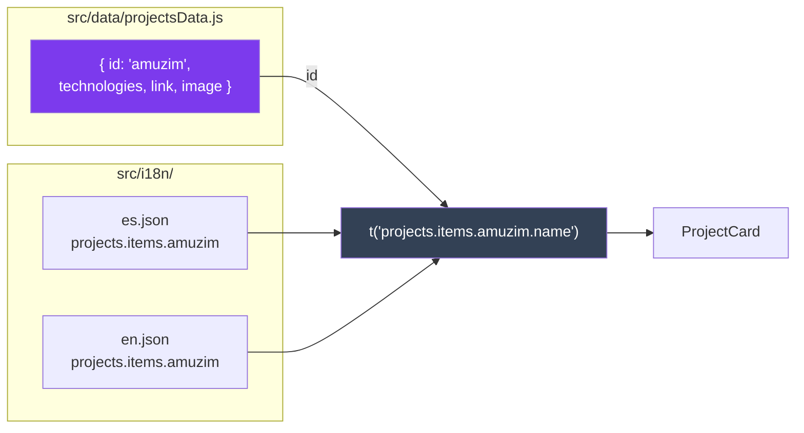
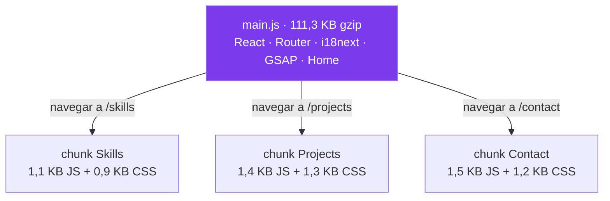
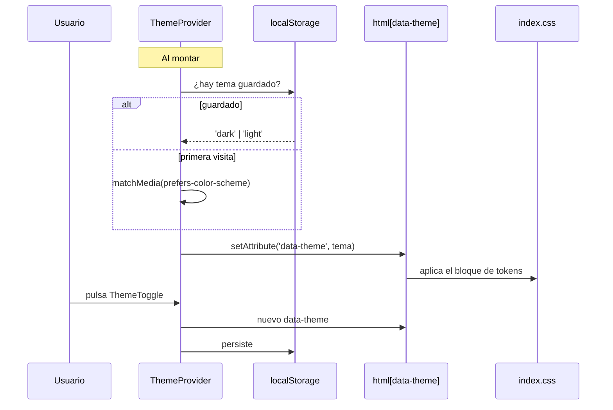
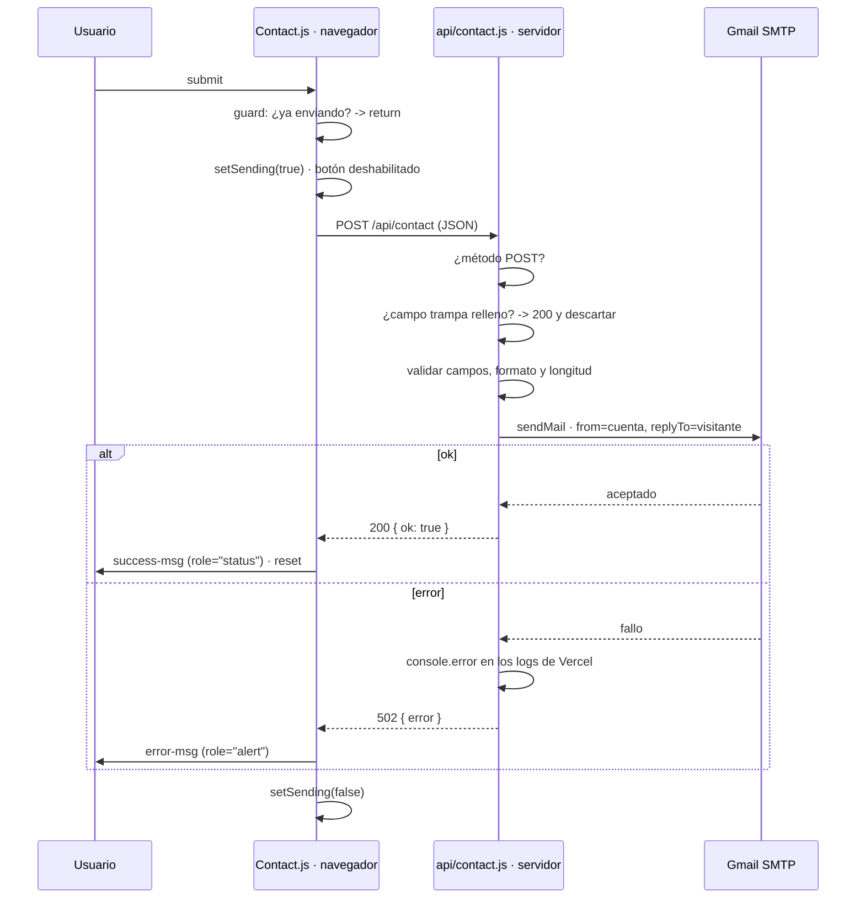
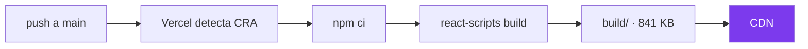

# Arquitectura

Cómo está montado el portfolio y por qué. Para las decisiones de diseño y sus
alternativas descartadas, ver [DECISIONS.md](DECISIONS.md).

---

## Panorama

SPA de React servida como estático desde Vercel, más una única función
serverless: el endpoint del formulario de contacto.



No hay base de datos, sesiones ni autenticación de usuarios. El contenido es
estático y vive en el repositorio.

**La función es la única pieza con estado sensible.** Sus credenciales
(`GMAIL_USER`, `GMAIL_APP_PASSWORD`) no llevan el prefijo `REACT_APP_` a
propósito: ese prefijo es justo lo que hace que Create React App incruste una
variable en el bundle del cliente. Al vivir solo en el servidor, son secretos de
verdad.

Los datos no traducibles viven en `src/data/` y los textos en `src/i18n/`.

---

## Árbol de componentes

`Header` y `Footer` quedan fuera de `<Routes>`: son persistentes y no se
desmontan al navegar. Solo cambia lo que hay dentro de `<main>`.



Los dos proveedores envuelven la app entera porque tanto el tema como el idioma
los consume el `Header`, que está fuera del router.

---

## Estructura de carpetas

```
src/
├── App.js              Router, rutas y frontera de Suspense
├── index.js            Punto de entrada: monta los proveedores
├── index.css           Tokens de tema, reset y reglas globales
│
├── components/         Piezas persistentes, compartidas entre rutas
│   ├── Header.js       Nav + selector de idioma + selector de tema
│   ├── Footer.js
│   ├── LanguageSwitcher.js
│   └── ThemeToggle.js
│
├── pages/              Una por ruta. Cada una con su CSS.
│   ├── Home.js         Ruta de entrada (estática)
│   ├── Skills.js       (lazy)
│   ├── Projects.js     (lazy)
│   └── Contact.js      (lazy)
│
├── data/               Solo lo que NO se traduce
│   ├── projectsData.js id, stack, enlace, imagen
│   └── skillsData.js   id de categoría, nombre e icono de cada tecnología
│
├── i18n/               Toda la copia visible
│   ├── es.json         78 claves
│   ├── en.json         78 claves (idénticas por contrato, hay test)
│   └── index.js        Configuración de i18next
│
├── context/
│   └── ThemeContext.js Tema claro/oscuro con persistencia
│
└── __tests__/          14 tests
```

`public/` contiene lo que se sirve tal cual: capturas de proyectos (WebP), avatar,
imagen de Open Graph, iconos de tecnologías, CV, sitemap y manifest. **Nada de
`public/` pasa por webpack** — es una copia literal al build, cosa a tener presente
antes de dejar ahí cualquier archivo.

---

## Resolución de contenido

El punto de diseño central. Los datos y su traducción están separados y se unen
por un `id` estable.



**Por qué importa:** antes los textos se resolvían por la *posición* en el array
(`t('projects.items.3.name')`). Eso acoplaba tres archivos entre sí: insertar o
borrar un proyecto en uno solo desplazaba los textos de todos los siguientes,
**sin romper el build**. El fallo solo se veía mirando la página. Con claves
estables, el orden deja de importar y una clave ausente es un fallo evidente.

Mismo patrón en `skillsData.js`: las categorías llevan `id` (`frontend`,
`backend`, `ai-tools`) y sus etiquetas viven en `skills.categories` del i18n.

### Reglas del i18n

1. **Ningún valor por defecto en `t()`.** El segundo argumento de
   `t('clave', 'texto')` devuelve ese texto cuando la clave falta, en silencio. Es
   cómo la app llegó a producción con la mitad de la interfaz sin traducir: sin
   warning, sin error de build, sin test en rojo. Las claves se declaran en ambos
   locales o no se usan.
2. **Los dos árboles son idénticos.** No es una convención, es un test
   (`i18n.test.js`).
3. **En desarrollo, una clave ausente escribe un error en consola** — ver el
   `missingKeyHandler` de `src/i18n/index.js`.

---

## Carga y chunks



**Home va en el chunk de entrada a propósito.** Es la ruta por defecto: cargarla
bajo demanda solo añadiría un viaje de red antes de poder pintarla.

GSAP también se queda en la entrada, porque Home lo usa. Es, junto a React,
React Router, i18next y react-icons, lo que domina el bundle. El first load de `/`
son **114,9 KB gzip** (111,3 JS + 3,6 CSS).

El reparto del CSS lo hace `mini-css-extract-plugin` siguiendo el grafo de chunks:
cada ruta lazy emite su propio CSS y lo inyecta con un `<link>` antes de resolver
el import dinámico, así que no hay destello de contenido sin estilo.

---

## Tema claro/oscuro



Los colores son custom properties redefinidas por `[data-theme='dark']`. Ningún
componente conoce un color: todos leen tokens (`--bg`, `--text`, `--accent`…).
Cambiar de tema es cambiar un atributo del `<html>` — sin recálculos en JS ni
CSS-in-JS.

`useTheme()` lanza un error explícito si se usa fuera del provider, en vez del
`TypeError` de destructuring que daba antes.

---

## Animación y movimiento

Cada página construye un timeline de GSAP al montar. Todos siguen el mismo patrón:

```js
const mm = gsap.matchMedia();
mm.add('(prefers-reduced-motion: no-preference)', () => {
  const tl = gsap.timeline(...);
  tl.fromTo(target, { opacity: 0 }, { opacity: 1 });
});
return () => mm.revert();
```

**El timeline solo se construye si no hay preferencia por reducir movimiento.** No
se pausa: pausarlo haría que GSAP aplicase el estado inicial (`opacity: 0`) y la
página entera quedaría en blanco. Esto es seguro porque ningún elemento animado
lleva `opacity: 0` en el CSS base — esa opacidad solo existe dentro del `from` de
cada tween, en JS. Si la animación no corre, el contenido se ve por CSS.

`mm.revert()` limpia todo lo creado en el contexto, y reacciona si el usuario
cambia la preferencia con la página ya abierta.

Lo que vive solo en CSS (los tres pulsos infinitos, las transiciones de hover, el
scroll suave) lo cubre el bloque `@media (prefers-reduced-motion: reduce)` al
final de `index.css`.

---

## Formulario de contacto



### Por qué una función y no un servicio de formularios

El formulario usaba EmailJS. Su cuenta desapareció y el endpoint empezó a devolver
`404 Account not found`, con lo que **el formulario estuvo roto sin que nadie se
enterara**: build correcto, tests en verde, y cualquier visitante que escribiera
veía "Error al enviar". Es el fallo de un tercero cuya vida no controlas.

La función elimina esa dependencia: si tu Gmail existe, el formulario funciona.

**Defensas de la función:**

| | |
|---|---|
| Método | Solo POST; el resto recibe 405 |
| Campo trampa | `website`, oculto por CSS y fuera del tabulador. Si viene relleno se descarta el envío devolviendo 200, para no avisar al bot |
| Validación | Campos obligatorios, formato de email y límites de longitud (100 / 254 / 5000) |
| Credenciales | Solo en el servidor. Verificado: no aparecen en el bundle |

**Sobre el remitente.** Gmail exige que el `from` sea la cuenta autenticada: no se
puede suplantar al visitante. Su dirección va en `replyTo`, así que al pulsar
Responder el correo le llega a él. Además de ser lo único que Gmail permite, es lo
correcto: falsear el `from` haría fallar SPF y los mensajes acabarían en spam.

**Limitación en desarrollo.** El servidor de `npm start` no sirve `/api`: eso lo
hace Vercel. Para probar el formulario en local hace falta `npx vercel dev`.

---

## Tests

14 tests sobre lo que puede romperse sin dar la cara. No buscan cobertura: cubren
los fallos que este proyecto ya tuvo.

| Archivo | Qué protege |
|---|---|
| `i18n.test.js` | Que `es.json` y `en.json` declaren las mismas claves, sin valores vacíos, y que cada proyecto y categoría tenga traducción en ambos. Es el contrato del i18n. |
| `Header.test.js` | Que la navegación **se traduzca de verdad** al pulsar EN. Es el test de regresión del bug que dejaba media web en español. Más el estado del menú móvil y del selector de idioma. |
| `Projects.test.js` | Una tarjeta por proyecto, los que tienen captura primero, `rel="noopener"` en los enlaces externos, y el acordeón. |

`setupTests.js` polirrellena `matchMedia`, que jsdom no implementa y `ThemeProvider`
consulta al inicializarse.

```bash
npm test                        # watch
CI=true npm test -- --watchAll=false
```

---

## Build y despliegue



`vercel.json` fija `GENERATE_SOURCEMAP=false`: el build publicaba 8,6 MB de source
maps con el código sin minificar.

El fallback de SPA para rutas profundas (`/projects` en directo, o recargar en
`/contact`) lo aplica Vercel por su preset de Create React App — no hace falta
declarar `rewrites`.

**Variables de entorno requeridas en Vercel:** `GMAIL_USER` y
`GMAIL_APP_PASSWORD`, más `CONTACT_TO` si se quiere recibir en otra dirección. Sin
ellas la app compila y funciona: solo falla el formulario, que devuelve 500
`server_misconfigured` y deja constancia en los logs de la función.

Las consume `api/contact.js` **en tiempo de ejecución**, así que cambiarlas no
obliga a reconstruir — a diferencia de las `REACT_APP_*`, que webpack incrusta en
tiempo de build.

---

## Rendimiento

Estado medido del build actual:

Medido sobre el build actual. Los pesos de `public/` son bytes reales, no lo que
reporta `du` (que cuenta bloques de disco y con archivos pequeños infla mucho).

| | Valor |
|---|---|
| **First load de `/`** | **114,9 KB gzip** (111,3 JS + 3,6 CSS) |
| `public/` completo | 435 KB |
| ├─ Imagen de Open Graph | 219,9 KB · 1200×630, solo la piden los scrapers |
| ├─ Capturas de proyecto | 146,3 KB · 8 WebP |
| ├─ Iconos de tecnologías | 33,1 KB · 18 SVG |
| ├─ Avatar | 7,7 KB · WebP de 280px |
| └─ CV | 5,4 KB |

La imagen de Open Graph es el archivo más pesado de `public/`, pero no la
descarga ningún visitante: solo la piden los scrapers de LinkedIn, X y WhatsApp
al compartir el enlace.

Las capturas se sirven a 800px de ancho y se muestran a ~377 CSS px, lo que cubre
pantallas 2x. El avatar es el LCP de la home: lleva `fetchpriority="high"` y
dimensiones explícitas.

**Deuda conocida:** `index.css:1` carga las fuentes con `@import` de Google Fonts,
lo que serializa tres viajes de red bloqueando el render (bajar `main.css` →
parsearlo → descubrir el `@import` → pedir el CSS → pedir los `.woff2`). Moverlo a
`preconnect` + `<link>` en `index.html` es la mejora pendiente de mayor impacto.

---

## Accesibilidad

- **Un `h1` por página**, sin saltos de nivel. Los encabezados se estilan por
  clase (`.section-title`), nunca por etiqueta, para que el nivel se elija por
  semántica sin que el CSS dependa de él.
- **`:focus-visible` global** con `--accent`, que contrasta sobre ambos temas.
  `:focus:not(:focus-visible)` evita el anillo al hacer clic con el ratón.
- **`prefers-reduced-motion`** respetado en GSAP y en CSS.
- El acordeón de proyectos usa `visibility` además de `max-height`: con `overflow`
  solo, los lectores de pantalla leían las nueve descripciones plegadas.
- El selector de idioma anuncia `aria-label` y `aria-pressed` por botón; la bandera
  va en un `<span aria-hidden>` porque una bandera no es un idioma.
